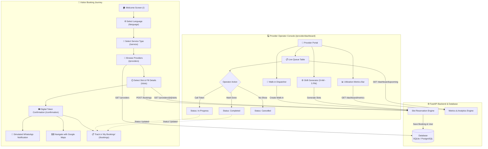

# ⏱️ BookUrTime: Comprehensive System Architecture & Specification

## 1. What is BookUrTime?
**BookUrTime** is a lightweight, mobile-first appointment booking and live queue management system. It is designed to modernize waiting rooms and counter operations for essential public and private services including **clinics/hospitals**, **Aadhaar Seva Kendras**, and **banks**.

---

## 2. What Problems Does It Solve?
1. **Unpredictable Physical Queuing:**
   - Citizens traditionally arrive early, queue up blindly, and waste hours waiting in crowded physical spaces without knowing when they will be served.
2. **Language & Accessibility Exclusion:**
   - Essential services are often accessed by citizens with diverse language backgrounds. Many booking apps are English-only and difficult to navigate. BookUrTime provides **6 native Indian languages** (English, Hindi, Telugu, Tamil, Bengali, Urdu) including **Right-to-Left (RTL)** layout for Urdu.
3. **High Operational Overhead for Providers:**
   - Small clinics, banks, and citizen service centers cannot afford complex enterprise scheduling software. BookUrTime provides an out-of-the-box **Provider Console** allowing counter staff to call the next guest, dispatch walk-ins, and generate daily shifts with zero friction.
4. **Network Resilience & Reliability:**
   - Public service centers often suffer from unreliable internet. BookUrTime operates with a **dual-mode architecture**: it communicates with the FastAPI backend when connected, but falls back seamlessly to `localStorage` client persistence when offline.

---

## 3. Core Features Breakdown

### 👤 Citizen / Visitor Flow
- **Multilingual Onboarding:** Select from 6 languages with immediate localized text and RTL layout adaptation.
- **Service Categories:** Specialized flows for Healthcare, Aadhaar/Government ID, and Banking.
- **Provider Discovery:** View distance in kilometers and live estimated wait badges.
- **Smart Slot Booking:** Clear Morning/Afternoon time-slot matrix with seat-locking validation.
- **Digital Confirmation Ticket:** Instant alphanumeric queue token (e.g., `HC-4821`, `AK-9102`), celebration animation, Google Maps navigation link, and simulated WhatsApp reminder.
- **Self-Service Queue Management:** View active tickets or cancel appointments at any time from "My Bookings".

### 🏢 Provider Console (Counter Staff & Admins)
- **Live Queue Monitor:** Filter appointments by status (`waiting`, `in-progress`, `completed`, `cancelled`) and advance tokens with one click.
- **Walk-in Dispatcher:** Issue immediate walk-in tokens at the desk with counter assignment and internal operator notes.
- **Shift & Interval Generator:** Automatically generate customized slot intervals (e.g. 15, 30, 45, 60 minutes) across the facility's working hours.
- **Capacity Analytics:** Real-time capacity utilization bar showing total slots, bookings, and active waiting load.

---

## 4. End-to-End Working Flowchart

---

## 5. Technology Stack

- **Frontend:** Next.js 16 (App Router), React 19, Tailwind CSS v4, Webpack compiler.
- **Backend:** FastAPI, Python 3.12+, SQLAlchemy 2.0 (Async).
- **Databases:** SQLite (local dev), PostgreSQL + `asyncpg` (production ready).
- **Infrastructure:** Render Web Service blueprint (`render.yaml`).
