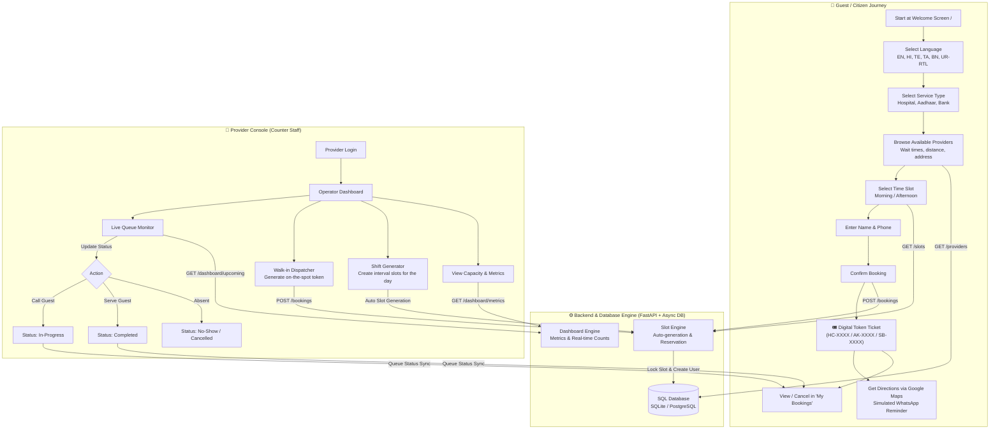

# ⏱️ BookUrTime

> **Smart Queue Management & Micro-Booking Platform for Essential Public & Private Services**

[](https://nextjs.org/)
[](https://fastapi.tiangolo.com/)
[](https://tailwindcss.com/)
[](https://www.sqlalchemy.org/)

---

## 📌 Executive Summary

**BookUrTime** is a lightweight, mobile-first appointment booking and live queue management system specifically designed for essential high-traffic service centers such as **Hospitals & Clinics**, **Aadhaar Seva Kendras**, and **Bank Branches**.

It bridges the gap between chaotic physical walk-in queues and overly complicated enterprise booking software by offering a frictionless, multilingual booking experience for citizens alongside an operator console for counter staff.

---

## 🛑 Problem Statement

Essential services in developing and densely populated regions face critical operational bottlenecks:

1. **Unpredictable Physical Queues:** Citizens spend hours waiting in cramped waiting rooms or standing in queues without knowing when they will be served.
2. **Language & Digital Literacy Barriers:** Most digital booking solutions are available only in English or standard regional variants with poor localized layouts, excluding a large demographic.
3. **High Overhead for Service Providers:** Small clinics, citizen service kiosks, and bank branches cannot afford or maintain complex, expensive ERPs just to manage counter lines.
4. **No-Shows & Disorganization:** Without automated token generation, estimated wait times, and reminders, crowds cluster during peak hours while later hours remain underutilized.

---

## 💡 The Solution

BookUrTime provides:
- **Instant Micro-Booking:** No app store downloads or forced account registrations. Visitors book with just a name and phone number in under 60 seconds.
- **Deep Multilingual Localization:** Native UI in **6 languages** (English, Hindi, Telugu, Tamil, Bengali, Urdu) including automatic **Right-to-Left (RTL)** layout rendering for Urdu.
- **Live Queue & Token System:** Clear, standardized tokens (`HC-` for Healthcare, `AK-` for Aadhaar, `SB-` for State Bank) with real-time estimated wait times.
- **Dual-Mode Architecture (Universal App):** One unified web application that allows visitors to book slots and counter operators to manage the live queue from the same platform.
- **Offline & Low-Bandwidth Resilience:** Built with an API-first approach that seamlessly falls back to local client persistence (`localStorage`) if the network or backend service is temporarily unreachable.

---

## 🔄 Working Flowchart



---

## ✨ Features

### 👤 Guest / Citizen Features
- **🌐 6-Language Native Localization:**
  - English (`en`), Hindi (`hi`), Telugu (`te`), Tamil (`ta`), Bengali (`bn`), Urdu (`ur`).
  - Automatic `dir="rtl"` layout and Nastaliq typography when Urdu is selected.
- **🏥 Category-Based Filtering:**
  - Pre-configured categories for Clinics/Hospitals, Aadhaar Seva Kendras, and Bank branches.
- **📍 Real-Time Wait & Distance Insights:**
  - Displays dynamic wait badges (`Low wait: <15 mins`, `Medium: 15-30 mins`, `High: >30 mins`) and kilometer distance.
- **🕒 Split Morning / Afternoon Slots:**
  - Clear time grid indicating available and booked slots to avoid overlapping.
- **🎉 Interactive Confirmation Ticket:**
  - Festive celebratory confetti burst on successful booking.
  - One-click Google Maps location navigation.
  - Realistic WhatsApp confirmation simulation.
- **📋 "My Bookings" Self-Service:**
  - List of past and upcoming appointments.
  - Instant cancellation with confirmation safeguards.

### 🏢 Provider & Operator Features
- **📊 Live Queue Control Panel:**
  - Real-time list of all guests categorized by status (`waiting`, `in-progress`, `completed`, `cancelled`).
  - One-click actions: **Call Next**, **Mark Served**, **Cancel / No-Show**.
- **⚡ Walk-in Appointment Dispatcher:**
  - Receptionists can register walk-in citizens on the spot with desk assignment (`Counter 1`, `Desk A`) and operational notes.
- **⏰ Shift & Slot Generator:**
  - Configure working hours (e.g. 09:00 to 17:00) and slot interval (15, 30, 45, 60 minutes) to auto-populate the day's schedule.
- **📈 Live Capacity Metrics:**
  - Visual metrics bar tracking total bookings, guests waiting, completed appointments, and capacity utilization percentage.
- **⚙️ Provider Profile Customization:**
  - Modify facility name, physical address, and service categories on the fly.

---

## 🛠️ Technology Stack

| Layer | Technologies Used |
| :--- | :--- |
| **Frontend Framework** | [Next.js 16](https://nextjs.org/) (App Router, Turbopack & Webpack support) |
| **UI Library & Styling** | React 19, [Tailwind CSS v4](https://tailwindcss.com/), Google Material Symbols |
| **State Management** | React Context (`BookingContext`) with bi-directional `localStorage` persistence |
| **Backend API** | [FastAPI](https://fastapi.tiangolo.com/) (Python 3.12 / 3.13) |
| **Database ORM** | [SQLAlchemy 2.0](https://www.sqlalchemy.org/) (Async engine with `aiosqlite` & `asyncpg`) |
| **Databases Supported** | SQLite (local development) / PostgreSQL (production) |
| **Validation & Schema** | Pydantic v2 & Pydantic-Settings |
| **Cloud Deployment** | Render Infrastructure as Code via [render.yaml](./render.yaml) |

---

## 🔌 API Endpoints Summary

| Method | Endpoint | Description |
| :--- | :--- | :--- |
| `GET` | `/` | API Health & welcome status |
| `GET` | `/providers` | List active providers filtered by service type & date |
| `GET` | `/providers/{id}/slots?date=YYYY-MM-DD` | Fetch / auto-generate available time slots for a provider |
| `POST` | `/bookings` | Create a new appointment, lock slot, and issue queue token |
| `PATCH` | `/bookings/{id}` | Update booking status (`waiting`, `in-progress`, `completed`, `cancelled`) |
| `DELETE` | `/bookings/{id}` | Cancel an appointment and release the time slot |
| `GET` | `/dashboard/metrics?providerId={id}&date={date}` | Retrieve provider capacity and queue metrics |
| `GET` | `/dashboard/upcoming?providerId={id}&date={date}` | List active queue appointments for provider |
| `POST` | `/reminders/send` | Trigger notification engine for appointments 24h & 2h out |

---

## 🚀 Local Development Setup

### 1. Prerequisites
- **Node.js** $\ge$ 18.x and **npm**
- **Python** $\ge$ 3.11 with `venv`

### 2. Backend Setup
```bash
# Navigate to backend directory
cd backend

# Create and activate virtual environment
python3 -m venv venv
source venv/bin/activate  # On Windows: venv\Scripts\activate

# Install dependencies
pip install -r requirements.txt

# Run FastAPI development server
python -m uvicorn main:app --host 127.0.0.1 --port 8000 --reload
```
*The backend API will start at http://127.0.0.1:8000 and interactive Swagger docs at http://127.0.0.1:8000/docs.*

### 3. Frontend Setup
```bash
# From project root:
cd frontend

# Install npm dependencies
npm install

# Start Next.js development server
npm run dev
```
*The frontend web app will be accessible at http://localhost:3000.*

---

## 📄 License

This project is licensed under the MIT License - see the LICENSE file for details.
